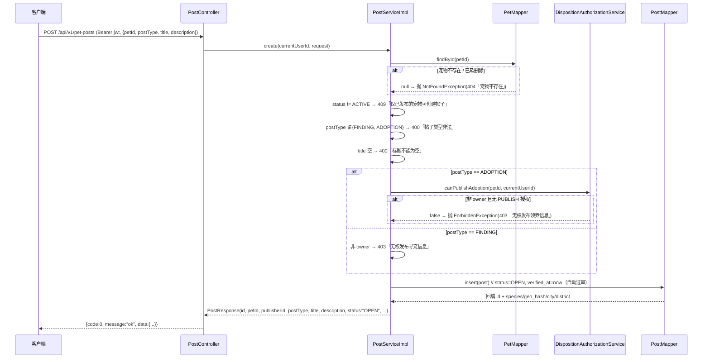
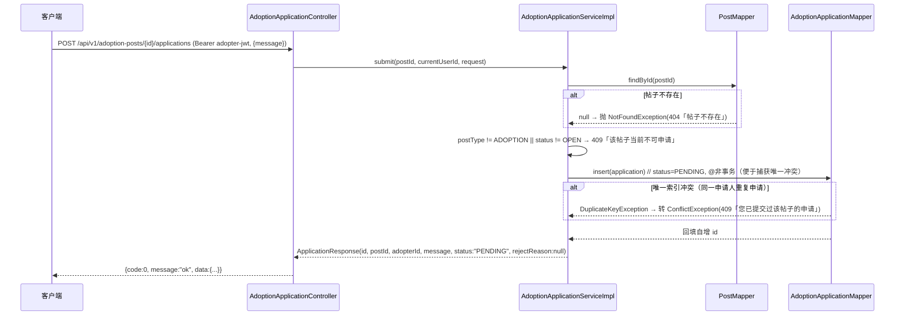
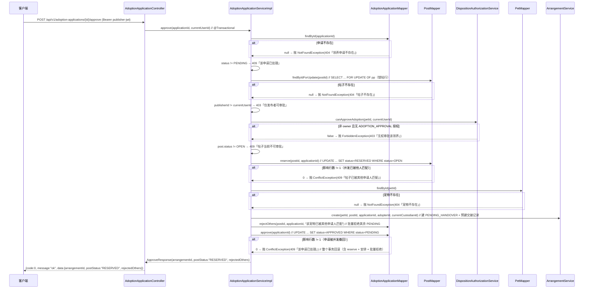
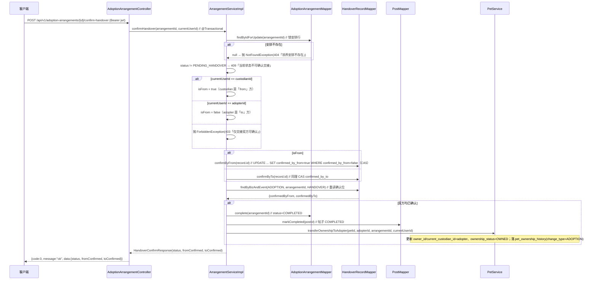
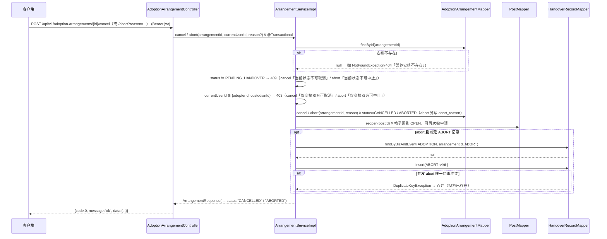

# 领养闭环（发布信息 / 申请审核 / 交接安排）功能说明

> 适用模块：`com.pethelp.post`（`PostController` / `PostServiceImpl` / `PostMapper`）、`com.pethelp.application`（`AdoptionApplicationController` / `AdoptionApplicationServiceImpl` / `AdoptionApplicationMapper`）、`com.pethelp.arrangement`（`AdoptionArrangementController` / `ArrangementServiceImpl` / `AdoptionArrangementMapper` / `HandoverRecordMapper`）、`com.pethelp.pet`（`PetService.transferOwnershipToAdopter`、`DispositionAuthorizationService`）
> 技术栈：Spring Boot 3.5 + MyBatis + PostgreSQL/PostGIS + Spring Security（JWT）
> 设计文档：`docs/superpowers/specs/2026-11-24-adoption-closed-loop-design.md`（对应 `docs/05-api.md` §5.3/5.4/5.5 的领养部分）

## 1. 领养闭环流程

统一前缀 `/api/v1`，鉴权 JWT，返回 `{code, message, data}`。完整链路：**owner 建宠物档案 → publish → 发 ADOPTION 帖子（自动过审 OPEN）→ adopter 提交申请 → owner 审批（单事务建安排 + 批量拒绝其余）→ 双方 confirm-handover（双确认幂等）→ 所有权转移给 adopter**。

### 1.1 发布领养信息（create post）时序图



### 1.2 提交领养申请（submit）时序图



### 1.3 审批（approve）单事务时序图



### 1.4 交接确认（confirm-handover）双确认幂等时序图



> 同一方重复 confirm：`confirmByFrom/To` 的 `WHERE confirmed_* = false` 使第二次影响 0 行，为**幂等 no-op**（仍返回 200，确认位不变、不重复写所有权历史）。

### 1.5 取消 / 异常中止（cancel / abort）时序图



## 2. 重要说明

- **自动过审**：创建帖子即 `status=OPEN`、`verified_at=now()`，无运营核实环节（`PENDING_VERIFY` 人工审核留 v0.2）。
- **approve 是唯一编排入口（单事务）**：`@Transactional` 内依次「锁帖行（`FOR UPDATE OF pp`）→ 校验 publisher/授权 → CAS `reserve`（`WHERE status='OPEN'`）→ `ArrangementService.create`（建 PENDING_HANDOVER + 预建交接记录）→ `rejectOthers`（批量拒绝其余 PENDING）→ `approve`」。三步更新（`reserve`/`approve`/`rejectOthers`）均校验影响行数，任一为 0 即抛 `ConflictException` 触发整体回滚，杜绝「帖子已 RESERVED 但安排未建 / 引用已撤回申请」等中间态。
- **跨模块同事务**：`ArrangementService.create`、`PetService.transferOwnershipToAdopter` 均为 `@Transactional`（默认 REQUIRED），被 approve / confirm-handover 调用时**加入外层事务**，无 `REQUIRES_NEW` / `@Async` 拆分。
- **交接双确认幂等**：`create` 时预建 `handover_records`（`biz_type=ADOPTION`、`event=HANDOVER`、`from=custodian`、`to=adopter`、两确认位 false）；`confirm-handover` 只按 `WHERE confirmed_* = false` 的 CAS 置位。双方都置位后才 `complete` + `markCompleted` + `transferOwnershipToAdopter`；同一方重复确认是 0 行 no-op，所有权不可能转移两次。
- **所有权转移**：`PetService.transferOwnershipToAdopter` 更新 `pets.owner_id`/`current_custodian_id = adopterId`、`ownership_status='OWNED'`，并落一条 `pet_ownership_history`（`change_type='ADOPTION'`、`from_owner_id`=原 owner、`to_owner_id`=adopter、`arrangement_id`）。并发控制依赖确认流程的**安排行锁**，非宠物更新层守卫。
- **状态机（大写蛇形枚举，客户端不传状态，全后端推导）**：
  - `pet_posts.status`：`OPEN → RESERVED → COMPLETED`（close 可 `OPEN/RESERVED → CLOSED`，cancel 可 `OPEN/RESERVED → CANCELLED`）。
  - `adoption_applications.status`：`PENDING → APPROVED / REJECTED / WITHDRAWN`。
  - `adoption_arrangements.status`：`PENDING_HANDOVER → COMPLETED / CANCELLED / ABORTED`。
- **取消/中止 reopen 帖子**：cancel/abort 都会 `reopen`（帖子 `RESERVED → OPEN`、清 `reserved_application_id`），使帖子可再次被申请。
- **精确位置不因交接自动放行**：`GET /pets/{id}/exact-location` 校验 `publisherId`（非 `owner_id`），交接后 adopter 虽成为 `owner_id` 但**仍是原发布者的 `publisherId`**，故仍需显式 `location-grants` 授权才能看精确坐标（见 `location-access.md`）。
- **并发兜底（局部唯一索引，V1 已建）**：`uq_adoption_application_pending (post_id, adopter_id) WHERE status='PENDING'` 防重复申请；`uq_active_adoption_arrangement_per_pet (pet_id) WHERE status='PENDING_HANDOVER'` 防同一宠物并发产生两个进行中的安排（**仅约束 PENDING_HANDOVER**，故领养完成后可对同一宠物再次发起领养）。
- **re-adoption 不阻塞**：首次领养 COMPLETED 后，adopter 成为新 `owner_id`，可对同一 pet 再次 `create` ADOPTION 帖子并审批，新安排正常创建（旧 COMPLETED 不冲突）。
- **处置授权（disposition authorization）**：`canPublishAdoption` 校验 `owner_id == userId 或 pet_authorizations 有 ACTIVE 的 PUBLISH 授权`；`canApproveAdoption` 校验 `owner_id == userId 或 ACTIVE 的 ADOPTION_APPROVAL 授权`。v0.1 无「授予处置授权」端点，`pet_authorizations` 表为空。
- **convert-to-adoption（寻主转领养）本期仅校验**：校验 FINDING+OPEN+发布者本人+pet `UNOWNED && AUTHORIZED` 后**恒 409**（「转领养功能暂未开放」），happy path（`markFindingConverted`）留 v0.2。
- **无新增依赖/迁移**：全部复用既有 `ForbiddenException`/`ConflictException`/`NotFoundException`/`BadRequestException`，表与索引已含于 `V1__init_schema.sql`。
- **本期不做（deferred）**：FOSTER（寄养）发布/申请/工单/归还、消息（5.6）、举报/运营（5.7）、真实运营核实、处置授权授予端点（届时需 V4 迁移把 `pet_authorizations.auth_type` 从 `varchar(16)` 扩为 `varchar(32)`，因 `ADOPTION_APPROVAL` 长 17 字符）、转领养 happy path。

## 3. 异常与错误码

统一返回 `{ code, message, data }`，`code` 前三位对应 HTTP 状态码。

| 端点 | 场景 | 触发点 | HTTP | code | message |
|---|---|---|---|---|---|
| create post | 宠物不存在（含软删除） | `petMapper.findById` null | 404 | 40400 | 宠物不存在 |
| create post | 宠物未发布 | `status != ACTIVE` | 409 | 40900 | 仅已发布的宠物可创建帖子 |
| create post | 帖子类型非法 | `postType ∉ {FINDING,ADOPTION}` | 400 | 40000 | 帖子类型非法 |
| create post | 标题为空 | `title null/blank` | 400 | 40000 | 标题不能为空 |
| create post | 无权发领养 | `canPublishAdoption` false | 403 | 40300 | 无权发布领养信息 |
| create post | 无权发寻宠 | FINDING 非 owner | 403 | 40300 | 无权发布寻宠信息 |
| list | 分页参数非法 | `page<1 || size<1` | 400 | 40000 | 分页参数非法 |
| update post | 帖子不存在 | `findById` null | 404 | 40400 | 帖子不存在 |
| update post | 非发布者 | `publisherId != currentUserId` | 403 | 40300 | 仅发布者可操作 |
| update post | 非 OPEN | `status != OPEN` | 409 | 40900 | 仅开放中的帖子可编辑 |
| close / cancel post | 帖子不存在 | `findById` null | 404 | 40400 | 帖子不存在 |
| close / cancel post | 非发布者 | `publisherId != currentUserId` | 403 | 40300 | 仅发布者可操作 |
| close post | 非 OPEN/RESERVED | 状态检查 | 409 | 40900 | 当前状态不可关闭 |
| cancel post | 非 OPEN/RESERVED | 状态检查 | 409 | 40900 | 当前状态不可取消 |
| convert-to-adoption | 非 FINDING+OPEN | 状态检查 | 409 | 40900 | 仅开放中的寻宠帖子可转领养 |
| convert-to-adoption | 非发布者 | `publisherId != currentUserId` | 403 | 40300 | 仅发布者可操作 |
| convert-to-adoption | 宠物非 UNOWNED+AUTHORIZED | 状态检查 | 409 | 40900 | 宠物需为无主且已授权方可转领养 |
| convert-to-adoption | 功能未开放（恒拒） | 末行 throw | 409 | 40900 | 转领养功能暂未开放 |
| submit | 帖子不存在 | `postMapper.findById` null | 404 | 40400 | 帖子不存在 |
| submit | 帖子非 ADOPTION 或非 OPEN | 状态检查 | 409 | 40900 | 该帖子当前不可申请 |
| submit | 重复申请 | 预检 / `DuplicateKeyException` | 409 | 40900 | 您已提交过该帖子的申请 |
| withdraw / reject / approve | 申请不存在 | `findById` null | 404 | 40400 | 领养申请不存在 |
| withdraw / reject / approve | 非 PENDING | 状态检查 | 409 | 40900 | 该申请已处理 |
| withdraw | 非申请人 | `adopterId != currentUserId` | 403 | 40300 | 仅申请人可撤回 |
| reject | 帖子不存在 | `postMapper.findById` null | 404 | 40400 | 帖子不存在 |
| reject | 非发布者 | `publisherId != currentUserId` | 403 | 40300 | 仅发布者可拒绝 |
| approve | 帖子不存在 | `findByIdForUpdate` null | 404 | 40400 | 帖子不存在 |
| approve | 非发布者 | `publisherId != currentUserId` | 403 | 40300 | 仅发布者可审批 |
| approve | 无权审批 | `canApproveAdoption` false | 403 | 40300 | 无权审批该领养 |
| approve | 帖子非 OPEN | 状态检查 | 409 | 40900 | 帖子当前不可审批 |
| approve | 已被他人匹配 | `reserve` 影响 0 行 | 409 | 40900 | 帖子已被其他申请人匹配 |
| approve | 宠物不存在 | `petMapper.findById` null | 404 | 40400 | 宠物不存在 |
| approve | 申请被并发撤回 | `approve` 影响 0 行 | 409 | 40900 | 该申请已处理 |
| confirm-handover | 安排不存在 | `findByIdForUpdate` null | 404 | 40400 | 领养安排不存在 |
| confirm-handover | 非 PENDING_HANDOVER | 状态检查 | 409 | 40900 | 当前状态不可确认交接 |
| confirm-handover | 非交接双方 | `userId ∉ {adopterId, custodianId}` | 403 | 40300 | 仅交接双方可确认 |
| cancel | 安排不存在 | `findById` null | 404 | 40400 | 领养安排不存在 |
| cancel | 非 PENDING_HANDOVER | 状态检查 | 409 | 40900 | 当前状态不可取消 |
| cancel | 非交接双方 | 参与者检查 | 403 | 40300 | 仅交接双方可取消 |
| abort | 安排不存在 | `findById` null | 404 | 40400 | 领养安排不存在 |
| abort | 非 PENDING_HANDOVER | 状态检查 | 409 | 40900 | 当前状态不可中止 |
| abort | 非交接双方 | 参与者检查 | 403 | 40300 | 仅交接双方可中止 |

**说明**

- `BadRequestException` / `ForbiddenException` / `NotFoundException` / `ConflictException` 均继承 `BusinessException`（`RuntimeException`），由 `GlobalExceptionHandler.handleBusiness` 统一映射到对应 HTTP 状态 + code。
- `@Transactional` 方法内抛出的 `BusinessException`（RuntimeException）会触发回滚，这是 approve/confirm-handover 保证原子性的关键。
- 软删除（DELETED）档案经 `PetMapper.findById`（`status != 'DELETED'`）过滤，返回 404 而非 409。
- 未预期的异常走 `GlobalExceptionHandler.handleUnexpected` → 500 / `50000`「服务器内部错误」。

## 4. 接口调试步骤

### 4.1 启动

```bash
# 1. 启动基础设施（PostgreSQL + PostGIS + Redis），compose 文件在 backend/ 下
cd backend
docker compose up -d
docker compose ps        # 等待 postgres / redis STATUS 为 healthy

# 2. 设置环境变量（DB_PASSWORD 必填，compose 与后端共用）

# 3. 启动后端
mvn spring-boot:run
```

默认端口 `8080`；健康检查：`curl http://localhost:8080/actuator/health`。

### 4.2 调用接口（curl 示例）

登录获取 token 的完整步骤见 `docs/archive/login-flow.md`。假设已取得三个角色的 token：owner 的 `<owner-jwt>`（`/auth/login` 返回 `data.userId`）、adopter 的 `<adopter-jwt>`、第二申请人 `<adopter2-jwt>`。

**① owner 建档案并发布**

```bash
curl -X POST http://localhost:8080/api/v1/pets \
  -H "Content-Type: application/json" -H "Authorization: Bearer <owner-jwt>" \
  -d '{"species":"CAT","breed":"中华田园猫"}'
# → {"code":0,"message":"ok","data":{"id":1,"status":"DRAFT",...}}

curl -X POST http://localhost:8080/api/v1/pets/1/publish \
  -H "Authorization: Bearer <owner-jwt>"
# → {"code":0,"message":"ok","data":{"id":1,"status":"ACTIVE",...}}
```

**② owner 发 ADOPTION 帖子（自动过审 OPEN）**

```bash
curl -X POST http://localhost:8080/api/v1/pet-posts \
  -H "Content-Type: application/json" -H "Authorization: Bearer <owner-jwt>" \
  -d '{"petId":1,"postType":"ADOPTION","title":"寻领养","description":"可爱猫咪"}'
# → {"code":0,"message":"ok","data":{"id":10,"petId":1,"publisherId":<owner-id>,"postType":"ADOPTION","status":"OPEN",...}}
```

**③ adopter 提交申请**

```bash
curl -X POST http://localhost:8080/api/v1/adoption-posts/10/applications \
  -H "Content-Type: application/json" -H "Authorization: Bearer <adopter-jwt>" \
  -d '{"message":"我想领养"}'
# → {"code":0,"message":"ok","data":{"id":30,"postId":10,"adopterId":<adopter-id>,"status":"PENDING","rejectReason":null}}
```

**④ owner 审批（返回安排 id）**

```bash
curl -X POST http://localhost:8080/api/v1/adoption-applications/30/approve \
  -H "Authorization: Bearer <owner-jwt>"
# → {"code":0,"message":"ok","data":{"arrangementId":40,"postStatus":"RESERVED","rejectedOthers":0}}
```

**⑤ 双方 confirm-handover（custodian 先，adopter 后）**

```bash
# owner（custodian = from 方）确认
curl -X POST http://localhost:8080/api/v1/adoption-arrangements/40/confirm-handover \
  -H "Authorization: Bearer <owner-jwt>"
# → {"code":0,"message":"ok","data":{"status":"PENDING_HANDOVER","fromConfirmed":true,"toConfirmed":false}}

# adopter（to 方）确认 → 完成 + 所有权转移
curl -X POST http://localhost:8080/api/v1/adoption-arrangements/40/confirm-handover \
  -H "Authorization: Bearer <adopter-jwt>"
# → {"code":0,"message":"ok","data":{"status":"COMPLETED","fromConfirmed":true,"toConfirmed":true}}
```

**⑥ 查询帖子确认 COMPLETED**

```bash
curl http://localhost:8080/api/v1/pet-posts/10
# → {"code":0,"message":"ok","data":{"id":10,"status":"COMPLETED",...}}
```

### 4.3 错误响应示例

```bash
# 重复申请（同一 adopter 第二次提交同一帖子）
curl -X POST http://localhost:8080/api/v1/adoption-posts/10/applications \
  -H "Content-Type: application/json" -H "Authorization: Bearer <adopter-jwt>" \
  -d '{"message":"再来一次"}'
# → HTTP 409 {"code":40900,"message":"您已提交过该帖子的申请","data":null}

# 非发布者审批
curl -X POST http://localhost:8080/api/v1/adoption-applications/30/approve \
  -H "Authorization: Bearer <adopter-jwt>"
# → HTTP 403 {"code":40300,"message":"仅发布者可审批","data":null}

# 非交接双方确认
curl -X POST http://localhost:8080/api/v1/adoption-arrangements/40/confirm-handover \
  -H "Authorization: Bearer <adopter2-jwt>"
# → HTTP 403 {"code":40300,"message":"仅交接双方可确认","data":null}

# 交接完成后 adopter 看精确位置（仍是原 owner 的 publisherId，需 location-grant）
curl http://localhost:8080/api/v1/pets/1/exact-location \
  -H "Authorization: Bearer <adopter-jwt>"
# → HTTP 403 {"code":40300,"message":"无权查看精确位置","data":null}

# 转领养（本期恒拒）
curl -X POST http://localhost:8080/api/v1/pet-posts/10/convert-to-adoption \
  -H "Authorization: Bearer <owner-jwt>"
# → HTTP 409 {"code":40900,"message":"转领养功能暂未开放","data":null}
```
