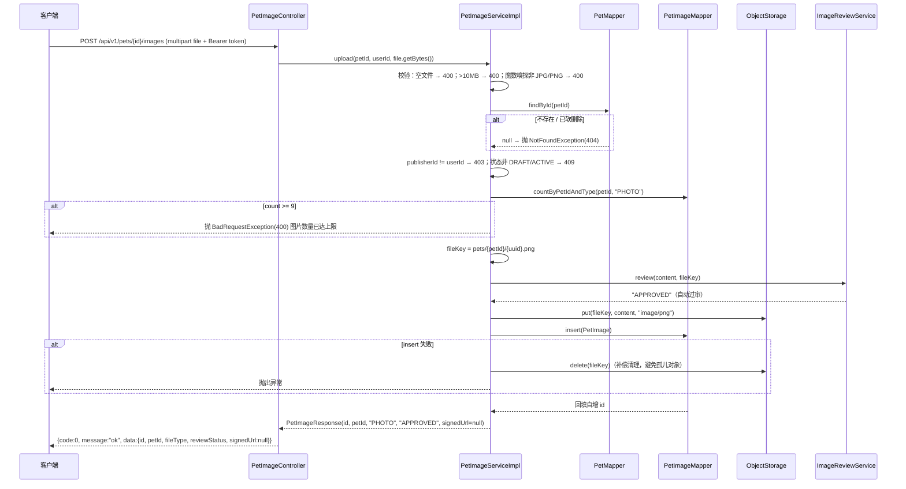
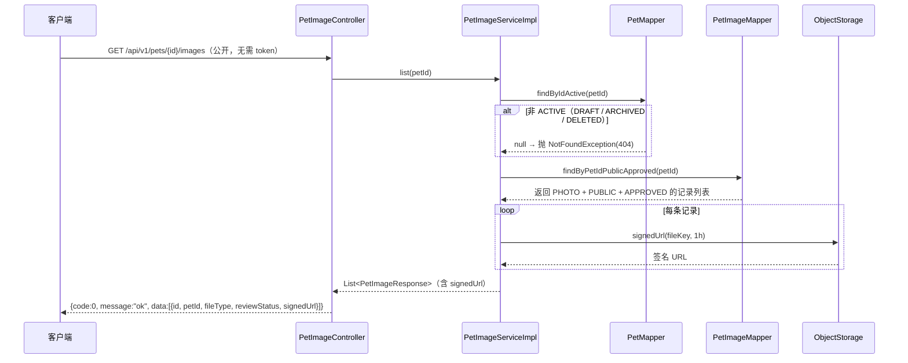

# 宠物图片上传功能说明

> 适用模块：`com.pethelp.picture.storage`、`com.pethelp.picture.review`、`com.pethelp.pet.service.impl.PetImageServiceImpl`、`com.pethelp.pet.controller.PetImageController`
> 技术栈：Spring Boot 3.5 + MyBatis + PostgreSQL/PostGIS + Redis + 阿里云 OSS SDK（可选）

## 1. 上传与列表流程

### 1.1 上传时序图



### 1.2 列表时序图



## 2. 重要说明

- **适配器隔离外部集成**：存储走 `ObjectStorage`（生产 `OssObjectStorage`，本地/测试 `InMemoryObjectStorage`）；审核走 `ImageReviewService`（当前 `AutoApproveImageReviewService` 恒返回 `APPROVED`，真实审核后续替换）。测试不连真实 OSS。
- **互斥装配**：`oss.enabled`（默认 `false`）决定装配哪个 `ObjectStorage`。默认内存实现；置 `true` 时才装配 `OSSClient` + `OssObjectStorage`（需 `oss.endpoint` / `oss.access-key-id` / `oss.access-key-secret` / `oss.bucket`）。
- **魔数嗅探不信任 Content-Type**：只认文件头字节 —— PNG `89 50 4E 47 0D 0A 1A 0A`、JPEG `FF D8 FF`。声明 `image/png` 但内容非 PNG 会 400。
- **私有 key 落库，永不下发永久 URL**：`pet_images.file_key` 存私有 key；上传响应 `signedUrl=null`，列表才返回 **1 小时** 签名 URL（`ObjectStorage.signedUrl`）。
- **仅支持 PHOTO**：`file_type` 恒为 `PHOTO`；`HEALTH_CERT` / `QUARANTINE` 本期不做。
- **数量与大小上限**：单档案最多 9 张 PHOTO、单文件 10MB（服务层 `MAX_BYTES` + `spring.servlet.multipart` 双重限制）。
- **可上传状态**：`DRAFT` / `ACTIVE` 可上传；`ARCHIVED` / `DELETED` 不可（分别 409 / 404）。
- **列表可见性**：仅 `status=ACTIVE` 且 `access_level=PUBLIC` 且 `review_status=APPROVED` 的 PHOTO 对外可见。`DRAFT` 档案可上传但列表隐藏（`findByIdActive` 只取 ACTIVE）。
- **补偿清理**：`put` 成功后若 `insert` 失败，会调用 `ObjectStorage.delete(fileKey)` 再抛出异常，避免留下无 `pet_images` 行的孤儿对象。
- **安全**：`GET /api/v1/pets/{id}/images` 公开（`permitAll`）；`POST` 需登录且仅档案发布者可操作（403）。
- **本期不做（deferred）**：封面图、删除图片接口、发布需 ≥1 张图门槛、真实/异步审核。

## 3. 异常与错误码

统一返回 `{ code, message, data }`，`code` 前三位对应 HTTP 状态码。

| 场景 | 触发点 | HTTP | code | message |
|---|---|---|---|---|
| 空文件（0 字节） | `upload` 校验 | 400 | 40000 | 文件为空 |
| 文件过大（>10MB） | `upload` 校验 / `MaxUploadSizeExceededException` | 400 | 40000 | 文件过大 |
| 非 JPG/PNG | 魔数嗅探 `sniff` | 400 | 40000 | 仅支持 JPG/PNG |
| 缺少 `file` 字段 | `MissingServletRequestPartException` | 400 | 40000 | 文件缺失 |
| 文件读取失败 | 控制器 `IOException` | 400 | 40000 | 文件读取失败 |
| 宠物不存在（含软删除） | `findById` / `findByIdActive` 返回 null | 404 | 40400 | 宠物不存在 |
| 非档案发布者 | 归属校验 `publisherId != userId` | 403 | 40300 | 仅档案发布者可操作 |
| 状态不可上传 | 非 `DRAFT`/`ACTIVE` | 409 | 40900 | 当前状态不可上传 |
| 图片数量达上限 | `countByPetIdAndType >= 9` | 400 | 40000 | 图片数量已达上限 |

**说明**

- `BadRequestException` / `ForbiddenException` / `NotFoundException` / `ConflictException` 均继承 `BusinessException`，由 `GlobalExceptionHandler.handleBusiness` 统一映射。
- `MaxUploadSizeExceededException`、`MissingServletRequestPartException` 有专门 handler 映射为 400，避免落入兜底 500。
- 软删除（DELETED）档案：`PetMapper.findById` 以 `status != 'DELETED'` 过滤，因此返回 404 而非 409。

## 4. 接口调试步骤

### 4.1 启动

```bash
# 1. 启动基础设施（PostgreSQL + PostGIS + Redis），compose 文件在 backend/ 下
cd backend
docker compose up -d
docker compose ps        # 等待 postgres / redis STATUS 为 healthy

# 2. 设置环境变量（DB_PASSWORD 必填，compose 与后端共用）
#    可按需 export，或写入根目录 .env 后 source

# 3. 启动后端
mvn spring-boot:run
```

默认端口 `8080`；健康检查：`curl http://localhost:8080/actuator/health` → `{"status":"UP",...}`。

### 4.2 调用接口（curl 示例）

登录获取 token 的完整步骤见 `docs/archive/login-flow.md`，这里只给关键结果。假设已取得 `<jwt>`。

**① 创建档案（得到 petId）**

```bash
curl -X POST http://localhost:8080/api/v1/pets \
  -H "Content-Type: application/json" \
  -H "Authorization: Bearer <jwt>" \
  -d '{"species":"CAT","breed":"中华田园猫"}'
# → {"code":0,"message":"ok","data":{"id":1,"status":"DRAFT",...}}
```

**② 上传图片（multipart）**

```bash
curl -X POST http://localhost:8080/api/v1/pets/1/images \
  -H "Authorization: Bearer <jwt>" \
  -F "file=@/path/to/a.png"
# → {"code":0,"message":"ok","data":{"id":7,"petId":1,"fileType":"PHOTO","reviewStatus":"APPROVED","signedUrl":null}}
```

> 上传返回的是图片 `id`，`signedUrl` 恒为 `null`；真正可访问的地址在列表接口返回。

**③ 列表（DRAFT 时 404，发布后 200）**

```bash
# 档案还是 DRAFT，列表不可见
curl http://localhost:8080/api/v1/pets/1/images
# → HTTP 404 {"code":40400,"message":"宠物不存在","data":null}

# 发布档案
curl -X POST http://localhost:8080/api/v1/pets/1/publish \
  -H "Authorization: Bearer <jwt>"
# → {"code":0,"message":"ok","data":{"id":1,"status":"ACTIVE",...}}

# 再次列表，返回 1 小时签名 URL
curl http://localhost:8080/api/v1/pets/1/images
# → {"code":0,"message":"ok","data":[{"id":7,"petId":1,"fileType":"PHOTO","reviewStatus":"APPROVED","signedUrl":"<signed-url>"}]}
```

> 本地内存实现下 `signedUrl` 形如 `memory://pets/1/<uuid>.png`；生产 OSS 为阿里云签名 URL。

### 4.3 错误响应示例

```bash
# 伪造 Content-Type（内容非 PNG 字节）
curl -X POST http://localhost:8080/api/v1/pets/1/images \
  -H "Authorization: Bearer <jwt>" \
  -F "file=@/tmp/fake.png;type=image/png"
# → HTTP 400 {"code":40000,"message":"仅支持 JPG/PNG","data":null}

# 非档案发布者上传（用他人 token）
curl -X POST http://localhost:8080/api/v1/pets/1/images \
  -H "Authorization: Bearer <other-jwt>" \
  -F "file=@/path/to/a.png"
# → HTTP 403 {"code":40300,"message":"仅档案发布者可操作","data":null}

# 不存在的档案
curl -X POST http://localhost:8080/api/v1/pets/999999/images \
  -H "Authorization: Bearer <jwt>" \
  -F "file=@/path/to/a.png"
# → HTTP 404 {"code":40400,"message":"宠物不存在","data":null}

# 缺少 file 字段
curl -X POST http://localhost:8080/api/v1/pets/1/images \
  -H "Authorization: Bearer <jwt>"
# → HTTP 400 {"code":40000,"message":"文件缺失","data":null}
```
