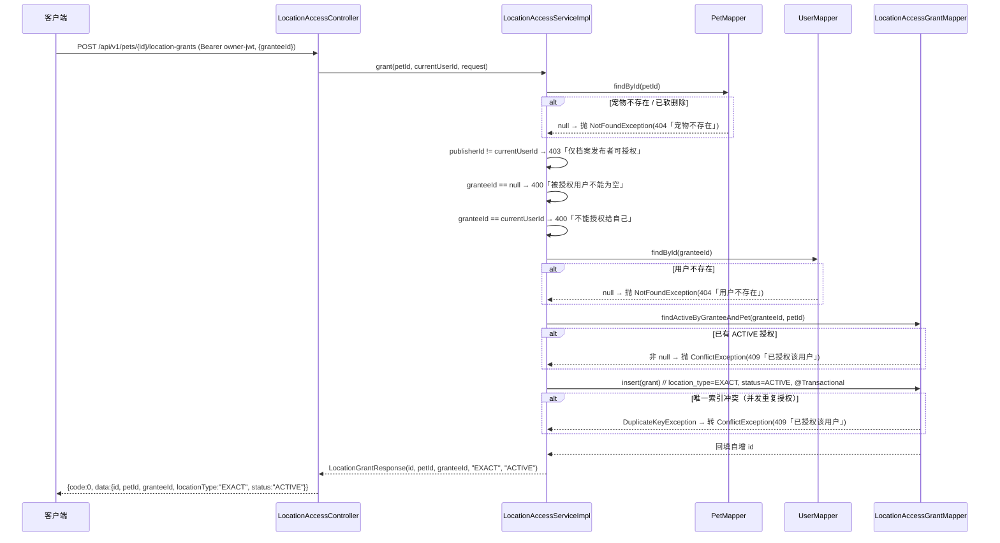
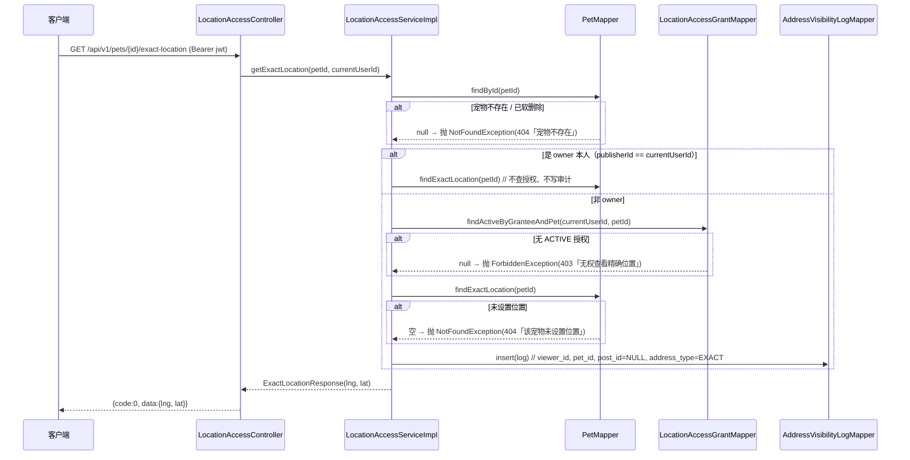
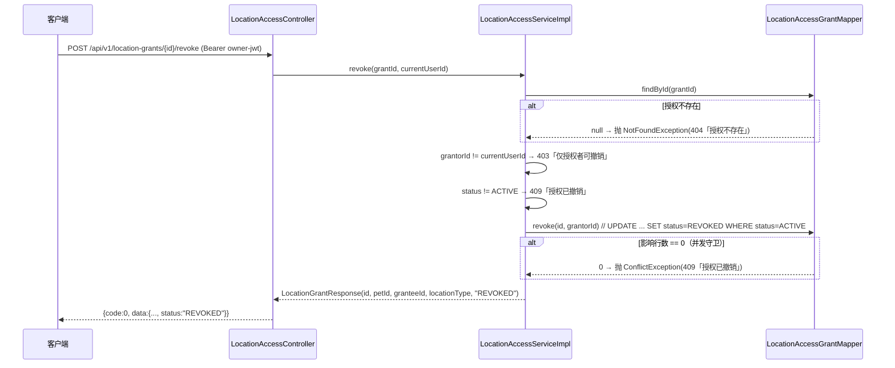

# 位置授权（精确位置授权）功能说明

> 适用模块：`com.pethelp.pet.controller.LocationAccessController`、`com.pethelp.pet.service.impl.LocationAccessServiceImpl`、`com.pethelp.pet.mapper.LocationAccessGrantMapper`、`com.pethelp.pet.mapper.AddressVisibilityLogMapper`、`com.pethelp.pet.mapper.PetMapper`
> 技术栈：Spring Boot 3.5 + MyBatis + PostgreSQL/PostGIS + Spring Security（JWT）
> 设计文档：`docs/superpowers/specs/2026-11-23-location-access-design.md`（对应 `docs/05-api.md` §5.2 剩余三项）

## 1. 三个端点的流程

统一前缀 `/api/v1`，鉴权 JWT，返回 `{code, message, data}`。精确坐标只在 `GET /exact-location` 返回，绝不进入公开 `GET /pets/{id}` 或 `PetResponse`。

### 1.1 授权（grant）时序图



### 1.2 查看精确位置（exact-location）时序图



> 审计只在**成功解析出坐标后**写入（`post_id` 恒 NULL、`address_type='EXACT'`）。owner 本人查看不写审计；被授权方查看才写，且仅在被授权方视角下写。

### 1.3 撤销（revoke）时序图



## 2. 重要说明

- **精确坐标不进实体**：`PetMapper.findById` / `findByIdActive` 均不查 `location` 列；唯一查坐标的地方是 `PetMapper.findExactLocation`（`SELECT ST_X(location) AS lng, ST_Y(location) AS lat ... WHERE location IS NOT NULL`），返回 `Map<String,Object>`，Service 内转 `Double`。公开 `GET /pets/{id}` 只回 `geo_hash`/`city`/`district`，无 `lng/lat`。
- **location_type 恒 EXACT、status 仅 ACTIVE/REVOKED、expires_at 恒 NULL**：本轮不做过期，客户端不传任何 `status`/`locationType`/`expiresAt`，全部后端推导。
- **owner 本人直接放行**：`pet.publisherId == currentUserId` 时直接返回坐标，不查授权表、不写审计（C10）。
- **访问审计**：被授权方每次**成功**查看精确位置写一条 `address_visibility_logs`（`address_type='EXACT'`、`post_id=NULL`）。owner 本人查看、未授权查看（403）、未设位置查看（404）均不写。
- **防重复授权**：V3 迁移加局部唯一索引 `uq_location_grant_active ON location_access_grants (pet_id, grantee_id) WHERE status='ACTIVE'`；`grant` 走 `@Transactional` + 友好预检，唯一约束冲突（`DuplicateKeyException`）捕获转 409。撤销后可再次授权（索引只约束 ACTIVE 行）。
- **revoke 原子守卫**：`UPDATE ... SET status='REVOKED', revoked_at=now() WHERE id=? AND grantor_id=? AND status='ACTIVE'`，影响行数 == 0 → 409。
- **可授权/可查看状态**：`grant`/`exact-location` 用 `findById`（仅过滤 `DELETED`），所以 DRAFT/ACTIVE/ARCHIVED 均可授权/查看，仅软删除的档案 404（C6，owner 在 DRAFT 阶段即可核对位置）。
- **本轮排除运营角色**：`GET /exact-location` 只对本人 + 被授权方开放，不放行 `admin`/`operator`（运营特殊访问归后续 `5.7 /admin/*`）。
- **无新增依赖/异常类**：复用 `ForbiddenException`/`ConflictException`/`NotFoundException`/`BadRequestException`；仅新增 1 个数据库迁移 V3。
- **本期不做（deferred）**：授权过期时间、授权列表查询、`location_type=AGREED`（约定交接位置，属交接模块）、操作审计（`audit_logs`）。

## 3. 异常与错误码

统一返回 `{ code, message, data }`，`code` 前三位对应 HTTP 状态码。

| 端点 | 场景 | 触发点 | HTTP | code | message |
|---|---|---|---|---|---|
| grant | 宠物不存在（含软删除） | `findById` 返回 null | 404 | 40400 | 宠物不存在 |
| grant | 非档案发布者 | `publisherId != currentUserId` | 403 | 40300 | 仅档案发布者可授权 |
| grant | 被授权用户为空 | `granteeId == null` | 400 | 40000 | 被授权用户不能为空 |
| grant | 授权给自己 | `granteeId == currentUserId` | 400 | 40000 | 不能授权给自己 |
| grant | 被授权用户不存在 | `userMapper.findById` 返回 null | 404 | 40400 | 用户不存在 |
| grant | 重复授权 | 预检命中 / `DuplicateKeyException` | 409 | 40900 | 已授权该用户 |
| exact-location | 宠物不存在（含软删除） | `findById` 返回 null | 404 | 40400 | 宠物不存在 |
| exact-location | 无授权 | `findActiveByGranteeAndPet` 返回 null | 403 | 40300 | 无权查看精确位置 |
| exact-location | 未设置位置 | `findExactLocation` 返回 null/空 | 404 | 40400 | 该宠物未设置位置 |
| revoke | 授权不存在 | `findById` 返回 null | 404 | 40400 | 授权不存在 |
| revoke | 非授权者 | `grantorId != currentUserId` | 403 | 40300 | 仅授权者可撤销 |
| revoke | 非 ACTIVE | `status != ACTIVE` 或影响行数 0 | 409 | 40900 | 授权已撤销 |

**说明**

- `BadRequestException` / `ForbiddenException` / `NotFoundException` / `ConflictException` 均继承 `BusinessException`，由 `GlobalExceptionHandler.handleBusiness` 统一映射。
- 软删除（DELETED）档案：`PetMapper.findById` 以 `status != 'DELETED'` 过滤，因此返回 404 而非 409。

## 4. 接口调试步骤

### 4.1 启动

```bash
# 1. 启动基础设施（PostgreSQL + PostGIS + Redis），compose 文件在 backend/ 下
cd backend
docker compose up -d
docker compose ps        # 等待 postgres / redis STATUS 为 healthy

# 2. 设置环境变量（DB_PASSWORD 必填，compose 与后端共用）

# 3. 启动后端
mvn spring-boot:run
```

默认端口 `8080`；健康检查：`curl http://localhost:8080/actuator/health`。

### 4.2 调用接口（curl 示例）

登录获取 token 的完整步骤见 `docs/archive/login-flow.md`，这里只给关键结果。假设已取得 owner 的 `<owner-jwt>` 与 grantee 的 `<grantee-jwt>`（`/auth/login` 返回 `data.userId` 即用户 id）。

**① 创建带坐标的档案（owner）**

```bash
curl -X POST http://localhost:8080/api/v1/pets \
  -H "Content-Type: application/json" \
  -H "Authorization: Bearer <owner-jwt>" \
  -d '{"species":"CAT","breed":"中华田园猫","lng":116.397,"lat":39.908}'
# → {"code":0,"message":"ok","data":{"id":1,"status":"DRAFT",...}}
```

**② owner 授权给用户 2**

```bash
curl -X POST http://localhost:8080/api/v1/pets/1/location-grants \
  -H "Content-Type: application/json" \
  -H "Authorization: Bearer <owner-jwt>" \
  -d '{"granteeId":2}'
# → {"code":0,"message":"ok","data":{"id":10,"petId":1,"granteeId":2,"locationType":"EXACT","status":"ACTIVE"}}
```

**③ 被授权方查看精确位置（写审计）**

```bash
curl http://localhost:8080/api/v1/pets/1/exact-location \
  -H "Authorization: Bearer <grantee-jwt>"
# → {"code":0,"message":"ok","data":{"lng":116.397,"lat":39.908}}
```

**④ owner 撤销授权**

```bash
curl -X POST http://localhost:8080/api/v1/location-grants/10/revoke \
  -H "Authorization: Bearer <owner-jwt>"
# → {"code":0,"message":"ok","data":{"id":10,"petId":1,"granteeId":2,"locationType":"EXACT","status":"REVOKED"}}
```

**⑤ 撤销后再查看 → 403**

```bash
curl http://localhost:8080/api/v1/pets/1/exact-location \
  -H "Authorization: Bearer <grantee-jwt>"
# → HTTP 403 {"code":40300,"message":"无权查看精确位置","data":null}
```

### 4.3 错误响应示例

```bash
# 非 owner 授权（用他人 token）
curl -X POST http://localhost:8080/api/v1/pets/1/location-grants \
  -H "Content-Type: application/json" -H "Authorization: Bearer <other-jwt>" \
  -d '{"granteeId":2}'
# → HTTP 403 {"code":40300,"message":"仅档案发布者可授权","data":null}

# 授权给自己
curl -X POST http://localhost:8080/api/v1/pets/1/location-grants \
  -H "Content-Type: application/json" -H "Authorization: Bearer <owner-jwt>" \
  -d '{"granteeId":1}'
# → HTTP 400 {"code":40000,"message":"不能授权给自己","data":null}

# 重复授权
curl -X POST http://localhost:8080/api/v1/pets/1/location-grants \
  -H "Content-Type: application/json" -H "Authorization: Bearer <owner-jwt>" \
  -d '{"granteeId":2}'
# → HTTP 409 {"code":40900,"message":"已授权该用户","data":null}

# 无位置档案查看（owner 本人）
curl http://localhost:8080/api/v1/pets/1/exact-location \
  -H "Authorization: Bearer <owner-jwt>"
# → HTTP 404 {"code":40400,"message":"该宠物未设置位置","data":null}
```
