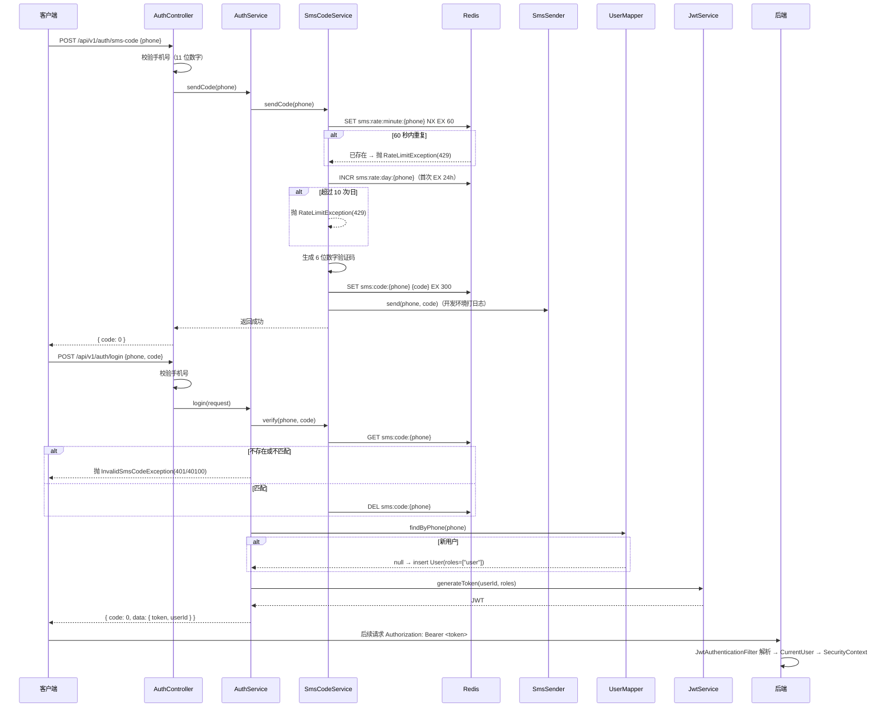

# 登录功能流程图、异常处理与接口调用指南

> 适用模块：`com.pethelp.auth`、`com.pethelp.user`、`com.pethelp.security`
> 技术栈：Spring Boot 3.5 + Spring Security 6 + JWT + MyBatis + Redis + PostgreSQL

## 1. 验证码登录流程

### 1.1 时序图



### 1.2 关键点

- **无密码**：仅「手机号 + 验证码」登录，首次登录自动注册（角色默认 `user`）。
- **验证码**：6 位数字，Redis key `sms:code:{phone}`，TTL 5 分钟，验证成功后立即删除（一次性）。
- **限流**：单号 60 秒 1 次（`sms:rate:minute:{phone}`）、单日 10 次（`sms:rate:day:{phone}`）。
- **JWT**：HS256 签名，有效期 `jwt.expiration`（默认 168h），负载含 `sub`(userId) 与 `roles`。
- **无状态认证**：每次请求经 `JwtAuthenticationFilter` 解析 `Bearer` 令牌并写入安全上下文，不依赖 session。

## 2. 突发情况处理（异常与错误码）

统一返回 `{ code, message, data }`，`code` 前三位对应 HTTP 状态码。

| 场景 | 触发点 | HTTP | code | message |
|---|---|---|---|---|
| 手机号格式非法 | `AuthController.validatePhone` | 400 | 40000 | 手机号格式不正确 |
| 验证码错误或已过期/已消费 | `AuthServiceImpl.login` → `verify` 失败 | 401 | 40100 | 验证码错误或已过期 |
| 未登录 / Token 缺失·失效·过期 | `RestAuthenticationEntryPoint` | 401 | 40100 | 未登录或登录已过期 |
| Token 签名/格式非法 | `JwtAuthenticationFilter`（解析失败清空上下文） | 401 | 40100 | 未登录或登录已过期 |
| 60 秒内重复发送 | `SmsCodeServiceImpl.sendCode` | 429 | 42900 | 发送太频繁，请稍后再试 |
| 当日发送次数超限 | `SmsCodeServiceImpl.sendCode` | 429 | 42900 | 今日发送次数已达上限 |
| 查询的用户不存在 | `UserServiceImpl.getProfile` | 404 | 40400 | 用户不存在 |
| 未捕获的内部异常 | `GlobalExceptionHandler` | 500 | 50000 | 服务器内部错误 |

**说明**

- `BadRequestException` / `InvalidSmsCodeException` / `NotFoundException` / `RateLimitException` 均继承 `BusinessException`，由 `GlobalExceptionHandler.handleBusiness` 统一映射为对应的 HTTP 状态 + 错误码。
- `JwtAuthenticationFilter` 解析失败时**静默清空上下文**（不抛异常），请求继续走到鉴权入口，由 `RestAuthenticationEntryPoint` 返回 401；因此「Token 非法」与「未携带 Token」对外表现一致。
- 验证码被成功消费后即删除，重放同一个 code 会得到 401（验证码错误或已过期）。

## 3. 启动项目并调用接口

### 3.1 启动

```bash
# 1. 启动基础设施（PostgreSQL + PostGIS + Redis）
docker compose up -d
docker compose ps        # 等待 STATUS 为 healthy

# 2. 加载环境变量（Spring Boot 不自动读取 .env）
set -a; source .env; set +a

# 3. 启动后端
mvn spring-boot:run
```

默认端口 `8080`；健康检查：`curl http://localhost:8080/actuator/health` → `{"status":"UP",...}`。

### 3.2 调用接口（curl 示例）

**① 发送验证码**

```bash
curl -X POST http://localhost:8080/api/v1/auth/sms-code \
  -H "Content-Type: application/json" \
  -d '{"phone":"13800138000"}'
# → {"code":0,"message":null,"data":null}
```

> 开发环境使用 `DevSmsSender`，验证码打印在后端日志：`[DEV SMS] phone=13800138000 code=123456`。
> 也可直接从 Redis 读取：`redis-cli GET sms:code:13800138000`。

**② 验证码登录（获取 token）**

```bash
curl -X POST http://localhost:8080/api/v1/auth/login \
  -H "Content-Type: application/json" \
  -d '{"phone":"13800138000","code":"123456"}'
# → {"code":0,"message":null,"data":{"token":"<jwt>","userId":1}}
```

**③ 获取当前用户信息**

```bash
curl http://localhost:8080/api/v1/users/me \
  -H "Authorization: Bearer <jwt>"
# → {"code":0,"message":null,"data":{"id":1,"phone":"13800138000","nickname":null,"avatar":null,"bio":null}}
```

**④ 更新个人资料**

```bash
curl -X PATCH http://localhost:8080/api/v1/users/me \
  -H "Content-Type: application/json" \
  -H "Authorization: Bearer <jwt>" \
  -d '{"nickname":"小助手","avatar":"avatar-key","bio":"你好"}'
```

**⑤ 查看他人公开资料**

```bash
curl http://localhost:8080/api/v1/users/1 \
  -H "Authorization: Bearer <jwt>"
```

### 3.3 错误响应示例

```bash
# 未登录访问受保护接口
curl http://localhost:8080/api/v1/users/me
# → HTTP 401 {"code":40100,"message":"未登录或登录已过期","data":null}

# 验证码错误
curl -X POST http://localhost:8080/api/v1/auth/login \
  -H "Content-Type: application/json" \
  -d '{"phone":"13800138000","code":"000000"}'
# → HTTP 401 {"code":40100,"message":"验证码错误或已过期","data":null}

# 60 秒内重复发送
curl -X POST http://localhost:8080/api/v1/auth/sms-code \
  -H "Content-Type: application/json" \
  -d '{"phone":"13800138000"}'
# → HTTP 429 {"code":42900,"message":"发送太频繁，请稍后再试","data":null}
```
