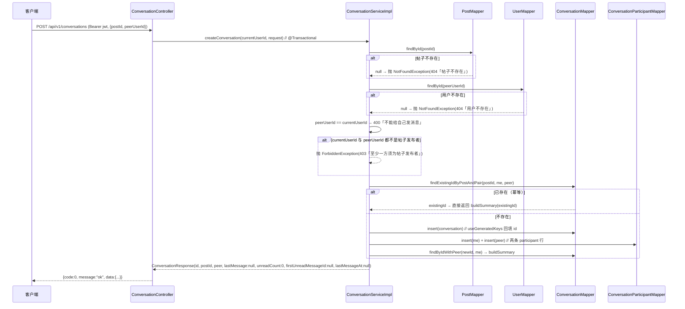
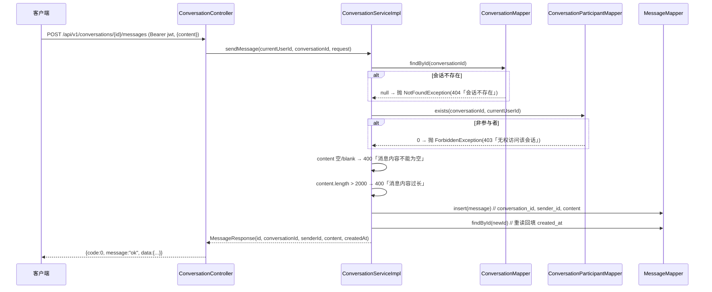
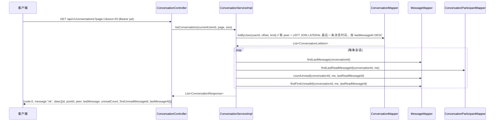
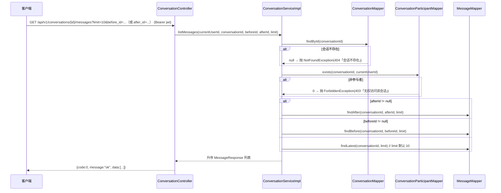
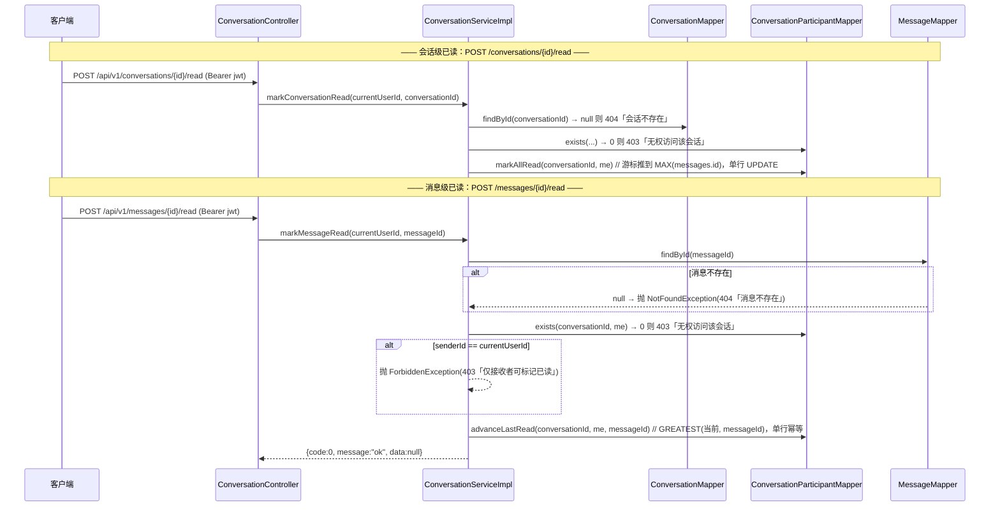

# 消息（会话 / 消息 / 已读）功能说明

> 适用模块：`com.pethelp.message`（`ConversationController` / `ConversationServiceImpl` / `MessageMapper` / `ConversationMapper` / `ConversationParticipantMapper`）
> 技术栈：Spring Boot 3.5 + MyBatis + PostgreSQL/PostGIS + Spring Security（JWT）
> 设计文档：`docs/superpowers/specs/2026-11-25-message-design.md`（对应 `docs/05-api.md` §5.6、`docs/04-database-design.md` §4.2 的 `conversations`/`conversation_participants`/`messages`）

## 1. 消息流程

统一前缀 `/api/v1`，鉴权 JWT（全端点需登录，未在 `permitAll` 白名单），返回 `{code, message, data}`。会话固定 **1:1**、强制关联帖子；消息/会话**无状态机**（生命周期即「追加 + 读游标推进」）。完整链路：**发起会话（至少一方是帖子发布者，幂等）→ 发送消息 → 拉会话列表（未读摘要）→ 拉消息（游标分页）→ 标记已读（会话级 / 消息级，游标单行更新）**。

### 1.1 发起会话（create conversation）时序图



### 1.2 发送消息（send message）时序图



> 发送**不受帖子状态影响**：帖子 `COMPLETED`/`CLOSED` 后双方仍可继续沟通（`createConversation` 只判帖子「行存在」，不看 `status`）。

### 1.3 拉会话列表（含未读摘要）时序图



### 1.4 拉消息（游标分页）时序图



### 1.5 标记已读（会话级 + 消息级）时序图



## 2. 重要说明

- **会话固定 1:1、强制关联帖子**：`conversations.post_id` 非空（V4 迁移 `SET NOT NULL`）；发起时写两条 `conversation_participants` 行；`GET /conversations` 的 `peer` = 非当前用户的另一参与者。**无「无帖子私信」**。
- **发起门槛（B）**：至少一方是帖子发布者（`me == publisherId || peer == publisherId`），否则 403。覆盖「申请人联系发布人」与「发布人联系被批准的申请人」两条链路，同时不放任任意私信。
- **消息收发不受帖子状态影响**：交接完成后帖子 `COMPLETED`/`CLOSED` 仍可继续沟通；`createConversation` 只判帖子行存在，不看 `status`。
- **读游标模型（非逐条已读）**：不在 `messages` 加 `read_at`，而在 `conversation_participants.last_read_message_id` 存游标；标记已读**只写这一行**，O(1) 单行 UPDATE，永不逐条更新 messages。
  - 会话级：`last_read_message_id = MAX(messages.id)`（该会话）。
  - 消息级：`last_read_message_id = GREATEST(COALESCE(last_read_message_id, 0), messageId)`。
  - 两者天然**幂等**：重复标记为 no-op，游标不变。
- **未读定义**（对我而言）：`messages WHERE conversation_id=? AND sender_id <> me AND id > COALESCE(last_read_message_id, 0)`；`unreadCount` 为该集合 `COUNT(*)`，`firstUnreadMessageId` 为 `MIN(id)`（无未读则 null，供前端定位「屏幕居中第一条未读」）。
- **消息列表游标分页（默认 N=10）**：`limit`（默认 10）+ 可选 `before_id`（更旧）/`after_id`（更新），均按 `conversation_id` 过滤、按 `id` 切片、最终升序返回；聊天场景新消息不断插入，偏移分页会错位，游标稳定且索引友好。
- **会话列表按 `lastMessageAt DESC` 排序**：`listByUser` 用 `LEFT JOIN LATERAL` 取每条会话最后一条消息的 `created_at` 排序（`NULLS LAST`，无消息的会话沉底，`c.id DESC` 作二级排序）。分页（`LIMIT/OFFSET`）在排序之后，故翻页不会错位。
- **防重复会话（应用层 find-or-create，无 DB 唯一索引）**：`createConversation` 事务内先 `findExistingIdByPostAndPair`（对「无序对」联 `conversation_participants` 两次），命中则返回已有会话；未命中才插入。并发窗口极小、后果是多余会话（无害）；如需硬约束可后续加功能唯一索引。
- **消息 content 校验**：非空且 ≤2000 字符（400），与 `messages.content NOT NULL` 对齐。
- **无新增 Maven 依赖**；本迭代唯一 schema 变更为 V4 迁移：`conversation_participants` 加 `last_read_message_id bigint`，`conversations.post_id SET NOT NULL`。
- **本期不做（deferred）**：群聊（会话固定 1:1）、已读回执/实时推送（WebSocket/MQ）、`notifications` 系统通知表、逐条已读回执。

## 3. 异常与错误码

统一返回 `{ code, message, data }`，`code` 前三位对应 HTTP 状态码。

| 端点 | 场景 | 触发点 | HTTP | code | message |
|---|---|---|---|---|---|
| list messages | 会话不存在 | `conversationMapper.findById` null | 404 | 40400 | 会话不存在 |
| list messages | 非参与者 | `participantMapper.exists` == 0 | 403 | 40300 | 无权访问该会话 |
| send message | 会话不存在 | `conversationMapper.findById` null | 404 | 40400 | 会话不存在 |
| send message | 非参与者 | `participantMapper.exists` == 0 | 403 | 40300 | 无权访问该会话 |
| send message | 内容为空 | `content null/blank` | 400 | 40000 | 消息内容不能为空 |
| send message | 内容过长 | `content.length > 2000` | 400 | 40000 | 消息内容过长 |
| create conversation | 帖子不存在 | `postMapper.findById` null | 404 | 40400 | 帖子不存在 |
| create conversation | 用户不存在 | `userMapper.findById` null | 404 | 40400 | 用户不存在 |
| create conversation | 给自己发消息 | `peerUserId == currentUserId` | 400 | 40000 | 不能给自己发消息 |
| create conversation | 双方都不是发布者 | 门槛检查 | 403 | 40300 | 至少一方须为帖子发布者 |
| mark conversation read | 会话不存在 | `conversationMapper.findById` null | 404 | 40400 | 会话不存在 |
| mark conversation read | 非参与者 | `participantMapper.exists` == 0 | 403 | 40300 | 无权访问该会话 |
| mark message read | 消息不存在 | `messageMapper.findById` null | 404 | 40400 | 消息不存在 |
| mark message read | 非参与者 | `participantMapper.exists` == 0 | 403 | 40300 | 无权访问该会话 |
| mark message read | 标记自己的消息 | `senderId == currentUserId` | 403 | 40300 | 仅接收者可标记已读 |

**说明**

- `BadRequestException` / `ForbiddenException` / `NotFoundException` 均继承 `BusinessException`（`RuntimeException`），由 `GlobalExceptionHandler.handleBusiness` 统一映射到对应 HTTP 状态 + code。
- 所有权限校验在 Service 层显式进行（`requireConversationAndParticipant` 等），**不用 `assert`**；客户端只传操作意图，绝不传业务状态（消息/会话无状态机）。
- 未预期的异常走 `GlobalExceptionHandler.handleUnexpected` → 500 / `50000`「服务器内部错误」。

## 4. 接口调试步骤

### 4.1 启动

```bash
# 1. 启动基础设施（PostgreSQL + PostGIS + Redis），compose 文件在 backend/ 下
cd backend
docker compose up -d
docker compose ps        # 等待 postgres / redis STATUS 为 healthy

# 2. 设置环境变量（DB_PASSWORD 必填，compose 与后端共用）

# 3. 启动后端
mvn spring-boot:run
```

默认端口 `8080`；健康检查：`curl http://localhost:8080/actuator/health`。

### 4.2 调用接口（curl 示例）

登录获取 token 的完整步骤见 `docs/archive/login-flow.md`。假设已取得两个角色：owner（发布者）的 `<owner-jwt>`、adopter 的 `<adopter-jwt>`，且已有一个领养帖子 `postId=10`（发布流程见 `docs/archive/adoption-closed-loop.md`）。

**① adopter 发起会话（peer = owner）**

```bash
curl -X POST http://localhost:8080/api/v1/conversations \
  -H "Content-Type: application/json" -H "Authorization: Bearer <adopter-jwt>" \
  -d '{"postId":10,"peerUserId":2}'
# → {"code":0,"message":"ok","data":{"id":1,"postId":10,"peer":{"id":2,"nickname":"小明","avatar":null},"lastMessage":null,"unreadCount":0,"firstUnreadMessageId":null,"lastMessageAt":null}}
```

**② 重复发起（幂等，返回同一会话）**

```bash
curl -X POST http://localhost:8080/api/v1/conversations \
  -H "Content-Type: application/json" -H "Authorization: Bearer <adopter-jwt>" \
  -d '{"postId":10,"peerUserId":2}'
# → {"code":0,"message":"ok","data":{"id":1,...}}   // 仍是 id=1，不新建
```

**③ adopter 发消息**

```bash
curl -X POST http://localhost:8080/api/v1/conversations/1/messages \
  -H "Content-Type: application/json" -H "Authorization: Bearer <adopter-jwt>" \
  -d '{"content":"你好，想了解一下交接时间"}'
# → {"code":0,"message":"ok","data":{"id":1,"conversationId":1,"senderId":3,"content":"你好，想了解一下交接时间","createdAt":"2026-11-25T..."}}
```

**④ owner 拉会话列表（看到未读）**

```bash
curl http://localhost:8080/api/v1/conversations \
  -H "Authorization: Bearer <owner-jwt>"
# → {"code":0,"message":"ok","data":[{"id":1,"postId":10,"peer":{"id":3,...},"lastMessage":{"content":"你好，想了解一下交接时间",...},"unreadCount":1,"firstUnreadMessageId":1,"lastMessageAt":"..."}]}
```

**⑤ owner 拉消息列表（游标分页）**

```bash
curl "http://localhost:8080/api/v1/conversations/1/messages?limit=10" \
  -H "Authorization: Bearer <owner-jwt>"
# → {"code":0,"message":"ok","data":[{"id":1,"conversationId":1,"senderId":3,"content":"你好，想了解一下交接时间","createdAt":"..."}]}
```

**⑥ owner 标记会话已读（未读清零）**

```bash
curl -X POST http://localhost:8080/api/v1/conversations/1/read \
  -H "Authorization: Bearer <owner-jwt>"
# → {"code":0,"message":"ok","data":null}

# 再拉列表，unreadCount 变 0
curl http://localhost:8080/api/v1/conversations -H "Authorization: Bearer <owner-jwt>"
# → ... "unreadCount":0 ...
```

**⑦ 标记单条消息已读（幂等）**

```bash
curl -X POST http://localhost:8080/api/v1/messages/1/read \
  -H "Authorization: Bearer <owner-jwt>"
# → {"code":0,"message":"ok","data":null}
```

### 4.3 错误响应示例

```bash
# 非参与者访问会话消息
curl http://localhost:8080/api/v1/conversations/1/messages \
  -H "Authorization: Bearer <stranger-jwt>"
# → HTTP 403 {"code":40300,"message":"无权访问该会话","data":null}

# 双方都不是帖子发布者时发起会话
curl -X POST http://localhost:8080/api/v1/conversations \
  -H "Content-Type: application/json" -H "Authorization: Bearer <stranger1-jwt>" \
  -d '{"postId":10,"peerUserId":999}'
# → HTTP 403 {"code":40300,"message":"至少一方须为帖子发布者","data":null}

# 发送空内容
curl -X POST http://localhost:8080/api/v1/conversations/1/messages \
  -H "Content-Type: application/json" -H "Authorization: Bearer <adopter-jwt>" \
  -d '{"content":""}'
# → HTTP 400 {"code":40000,"message":"消息内容不能为空","data":null}

# 发送者标记自己的消息为已读
curl -X POST http://localhost:8080/api/v1/messages/1/read \
  -H "Authorization: Bearer <adopter-jwt>"
# → HTTP 403 {"code":40300,"message":"仅接收者可标记已读","data":null}
```
