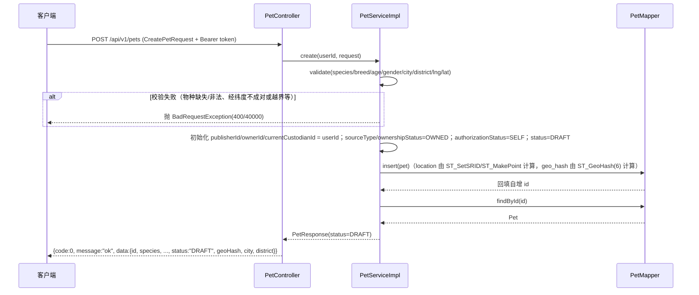
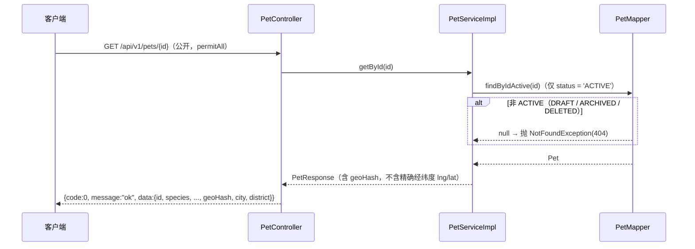
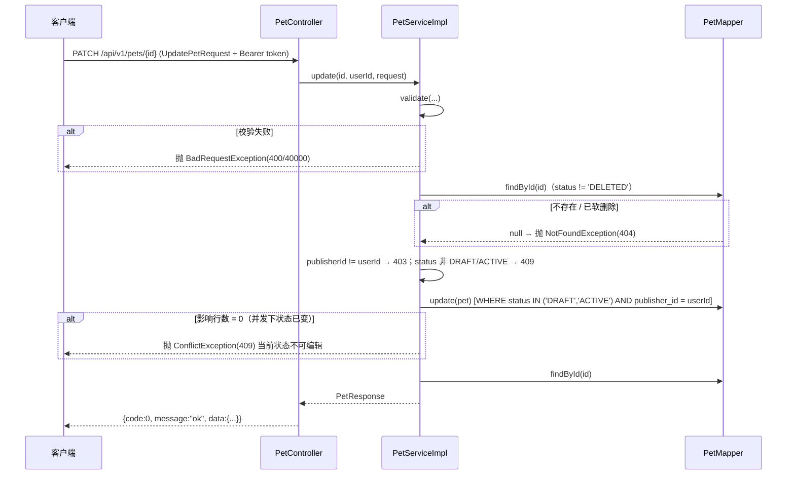
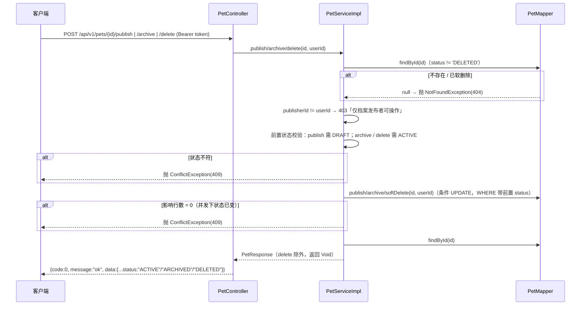

# 宠物档案功能说明

> 适用模块：`com.pethelp.pet`（controller / service / dto / entity / mapper）、`com.pethelp.common`、`com.pethelp.security`
> 技术栈：Spring Boot 3.5 + MyBatis + PostgreSQL/PostGIS + Spring Security 6 + JWT

本文档覆盖 `PetController` 的档案创建、查询、更新与状态流转接口。宠物图片上传/列表由 `PetImageController` 承担，见 [image-upload.md](./image-upload.md)。

## 1. 宠物档案流程

### 1.1 创建档案时序图



### 1.2 查询档案时序图（公开）



### 1.3 更新档案时序图



### 1.4 状态流转时序图（发布 / 归档 / 删除）

三条转移共用同一套「存在性 → 归属 → 前置状态 → 条件更新」守卫，仅目标状态与 message 不同。



状态机（`pets.status`）：

| 当前 → 目标 | 事件 | 前置条件 | SQL 更新 |
|---|---|---|---|
| `DRAFT` → `ACTIVE` | 发布 | 归属正确 + 当前 DRAFT | status='ACTIVE', version+1 |
| `ACTIVE` → `ARCHIVED` | 归档 | 归属正确 + 当前 ACTIVE | status='ARCHIVED', version+1 |
| `ACTIVE` → `DELETED` | 删除 | 归属正确 + 当前 ACTIVE | status='DELETED', deleted_at=now(), version+1 |

## 2. 重要说明

- **归属校验**：`publisher_id` 是档案的发布者标识，创建时 `publisherId = ownerId = currentCustodianId = 当前登录用户`。所有写操作（更新/发布/归档/删除/上传图片）均校验「仅档案发布者可操作」，否则 403。
- **状态机在后端强制执行**：前端不得传入状态。目标状态由操作意图推导（`publish` → ACTIVE、`archive` → ARCHIVED、`delete` → DELETED），条件 UPDATE 的 `WHERE` 子句带前置状态，配合乐观锁 `version = version + 1`，防止并发下状态漂移；`WHERE` 匹配 0 行时抛 409。
- **软删除**：`delete` 仅置 `status='DELETED'` 并写 `deleted_at`（V2 迁移新增字段），不物理删除。`findById` 以 `status != 'DELETED'` 过滤，因此软删除档案对外一律表现为 404 而非 409。
- **精确位置永不外发**：`pets.location` 存精确 `geometry(Point,4326)`，但所有 `SELECT` 均不返回 `location` 列，`PetResponse` 也不含 `lng/lat`，只返回 6 位精度 `geo_hash`（模糊位置）。经纬度仅由服务端在 INSERT/UPDATE 时写入。
- **查询只暴露 ACTIVE**：`getById` 走 `findByIdActive`（`status='ACTIVE'`），因此刚创建的 `DRAFT` 档案在 `GET /api/v1/pets/{id}` 上返回 404，需先 `publish` 才对外可见；但写操作（更新/发布）用 `findById` 可取到 DRAFT。
- **公开读接口**：`GET /api/v1/pets/{id}` 与 `GET /api/v1/pets/{id}/images` 在 `SecurityConfig` 中 `permitAll`；其余档案接口均需登录。
- **编辑/上传可操作状态**：`update` 允许 `DRAFT`/`ACTIVE`（`ARCHIVED`/`DELETED` 报 409/404）；图片上传同样仅 `DRAFT`/`ACTIVE`（见 image-upload.md）。
- **图片与档案解耦**：图片能力由 `PetImageController` + `PetImageServiceImpl` 提供，依赖 `picture.storage.ObjectStorage` 与 `picture.review.ImageReviewService` 两个 SPI，档案本体不感知存储与审核细节。详见 [image-upload.md](./image-upload.md)。
- **本期不做（deferred）**：发布前强制 ≥1 张过审图片的门槛、封面图、删除单张图片、`ownership_status`/`authorization_status` 的流转与授权关系表联动（`pet_authorizations` 表已建但未接入业务）。

## 3. 异常与错误码

统一返回 `{ code, message, data }`，`code` 前三位对应 HTTP 状态码。

| 场景 | 触发点 | HTTP | code | message |
|---|---|---|---|---|
| 物种为空 | `validate` | 400 | 40000 | 物种不能为空 |
| 物种取值非法（非 CAT/DOG/OTHER） | `validate` | 400 | 40000 | 物种取值非法 |
| 性别取值非法（非 MALE/FEMALE/UNKNOWN） | `validate` | 400 | 40000 | 性别取值非法 |
| 品种过长（>64） | `validate` | 400 | 40000 | 品种过长 |
| 年龄过长（>32） | `validate` | 400 | 40000 | 年龄过长 |
| 城市过长（>64） | `validate` | 400 | 40000 | 城市过长 |
| 区县过长（>64） | `validate` | 400 | 40000 | 区县过长 |
| 经纬度未成对提供 | `validate` | 400 | 40000 | 经纬度需成对提供 |
| 经度越界（非 [-180,180]） | `validate` | 400 | 40000 | 经度越界 |
| 纬度越界（非 [-90,90]） | `validate` | 400 | 40000 | 纬度越界 |
| 未登录 / Token 缺失·失效·过期 | `RestAuthenticationEntryPoint` | 401 | 40100 | 未登录或登录已过期 |
| 宠物不存在（含软删除，或查询时非 ACTIVE） | `findById` / `findByIdActive` 返回 null | 404 | 40400 | 宠物不存在 |
| 非档案发布者 | 归属校验 `publisherId != userId` | 403 | 40300 | 仅档案发布者可操作 |
| 更新时状态不可编辑（非 DRAFT/ACTIVE） | `update` 校验 / 条件 UPDATE 0 行 | 409 | 40900 | 当前状态不可编辑 |
| 发布时状态不可发布（非 DRAFT） | `publish` 校验 / 条件 UPDATE 0 行 | 409 | 40900 | 当前状态不可发布 |
| 归档时状态不可归档（非 ACTIVE） | `archive` 校验 / 条件 UPDATE 0 行 | 409 | 40900 | 当前状态不可归档 |
| 删除时状态不可删除（非 ACTIVE） | `delete` 校验 / 条件 UPDATE 0 行 | 409 | 40900 | 当前状态不可删除 |

**说明**

- `BadRequestException` / `ForbiddenException` / `NotFoundException` / `ConflictException` 均继承 `BusinessException`，由 `GlobalExceptionHandler.handleBusiness` 统一映射为对应 HTTP 状态 + 错误码。
- 图片上传/列表的错误码（`文件为空`、`文件过大`、`仅支持 JPG/PNG`、`文件缺失`、`图片数量已达上限` 等）见 [image-upload.md](./image-upload.md)。
- `GET /api/v1/pets/{id}` 对 `DRAFT`/`ARCHIVED`/`DELETED` 均返回 404（`findByIdActive` 只取 ACTIVE），与「软删除表现为 404」一致。
- 未捕获的内部异常由 `GlobalExceptionHandler.handleUnexpected` 兜底为 500/50000「服务器内部错误」。

## 4. 接口调试步骤

### 4.1 启动

```bash
# 1. 启动基础设施（PostgreSQL + PostGIS + Redis），compose 文件在 backend/ 下
cd backend
docker compose up -d
docker compose ps        # 等待 postgres / redis STATUS 为 healthy

# 2. 设置环境变量（DB_PASSWORD 必填，compose 与后端共用）
#    可按需 export，或写入根目录 .env 后 source

# 3. 启动后端
mvn spring-boot:run
```

默认端口 `8080`；健康检查：`curl http://localhost:8080/actuator/health` → `{"status":"UP",...}`。

### 4.2 调用接口（curl 示例）

登录获取 token 的完整步骤见 [login-flow.md](./login-flow.md)，这里只给关键结果。假设已取得 `<jwt>`。

**① 创建档案（得到 petId，初始 DRAFT）**

```bash
curl -X POST http://localhost:8080/api/v1/pets \
  -H "Content-Type: application/json" \
  -H "Authorization: Bearer <jwt>" \
  -d '{"species":"CAT","breed":"中华田园猫","gender":"FEMALE","age":"2岁","city":"上海","district":"徐汇区","lng":121.47,"lat":31.23}'
# → {"code":0,"message":"ok","data":{"id":1,"species":"CAT","breed":"中华田园猫","status":"DRAFT","geoHash":"wtw3...","city":"上海","district":"徐汇区"}}
```

**② 查询档案（DRAFT 时 404，发布后 200）**

```bash
# 刚创建仍是 DRAFT，公开查询不可见
curl http://localhost:8080/api/v1/pets/1
# → HTTP 404 {"code":40400,"message":"宠物不存在","data":null}

# 发布后可见
curl -X POST http://localhost:8080/api/v1/pets/1/publish \
  -H "Authorization: Bearer <jwt>"
# → {"code":0,"message":"ok","data":{"id":1,"status":"ACTIVE",...}}

curl http://localhost:8080/api/v1/pets/1
# → {"code":0,"message":"ok","data":{"id":1,"status":"ACTIVE","geoHash":"wtw3...","city":"上海","district":"徐汇区"}}
```

**③ 更新档案**

```bash
curl -X PATCH http://localhost:8080/api/v1/pets/1 \
  -H "Content-Type: application/json" \
  -H "Authorization: Bearer <jwt>" \
  -d '{"species":"CAT","breed":"中华田园猫","age":"3岁"}'
# → {"code":0,"message":"ok","data":{"id":1,"breed":"中华田园猫","age":"3岁",...}}
```

**④ 归档**

```bash
curl -X POST http://localhost:8080/api/v1/pets/1/archive \
  -H "Authorization: Bearer <jwt>"
# → {"code":0,"message":"ok","data":{"id":1,"status":"ARCHIVED",...}}
```

**⑤ 删除（软删除）**

```bash
curl -X POST http://localhost:8080/api/v1/pets/1/delete \
  -H "Authorization: Bearer <jwt>"
# → {"code":0,"message":"ok","data":null}
```

### 4.3 错误响应示例

```bash
# 未登录创建档案
curl -X POST http://localhost:8080/api/v1/pets \
  -H "Content-Type: application/json" \
  -d '{"species":"CAT"}'
# → HTTP 401 {"code":40100,"message":"未登录或登录已过期","data":null}

# 物种取值非法
curl -X POST http://localhost:8080/api/v1/pets \
  -H "Content-Type: application/json" \
  -H "Authorization: Bearer <jwt>" \
  -d '{"species":"BIRD"}'
# → HTTP 400 {"code":40000,"message":"物种取值非法","data":null}

# 经纬度未成对提供
curl -X POST http://localhost:8080/api/v1/pets \
  -H "Content-Type: application/json" \
  -H "Authorization: Bearer <jwt>" \
  -d '{"species":"CAT","lng":121.47}'
# → HTTP 400 {"code":40000,"message":"经纬度需成对提供","data":null}

# 非档案发布者更新（用他人 token）
curl -X PATCH http://localhost:8080/api/v1/pets/1 \
  -H "Content-Type: application/json" \
  -H "Authorization: Bearer <other-jwt>" \
  -d '{"species":"CAT"}'
# → HTTP 403 {"code":40300,"message":"仅档案发布者可操作","data":null}

# 查询不存在的档案
curl http://localhost:8080/api/v1/pets/999999
# → HTTP 404 {"code":40400,"message":"宠物不存在","data":null}

# 对非 DRAFT 档案重复发布
curl -X POST http://localhost:8080/api/v1/pets/1/publish \
  -H "Authorization: Bearer <jwt>"
# → HTTP 409 {"code":40900,"message":"当前状态不可发布","data":null}
```
