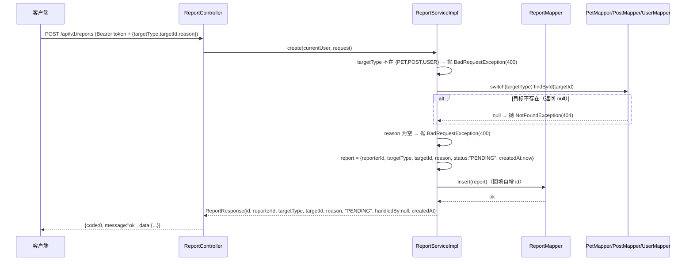
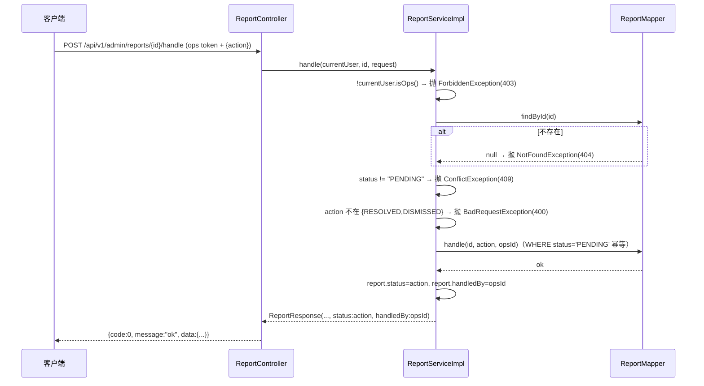
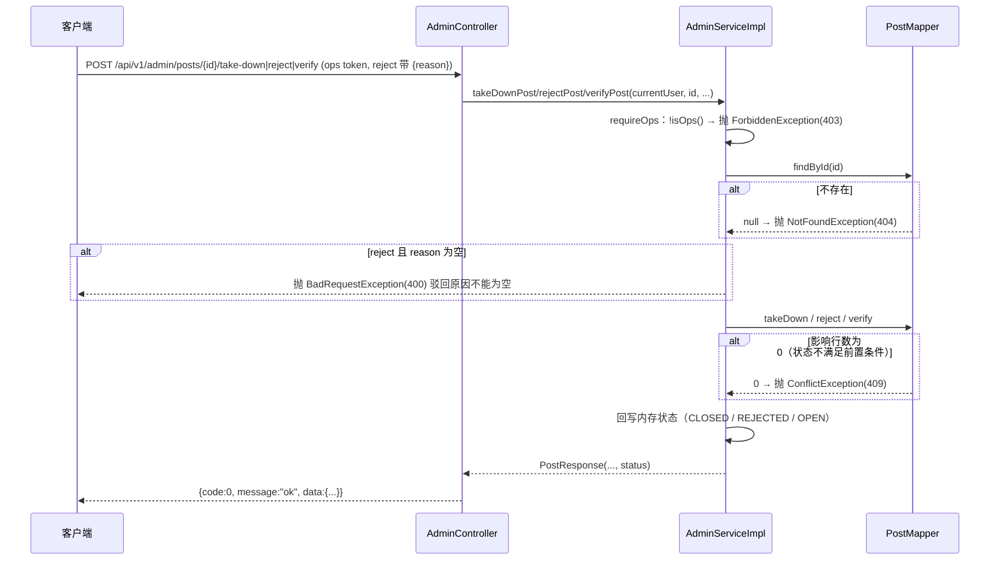
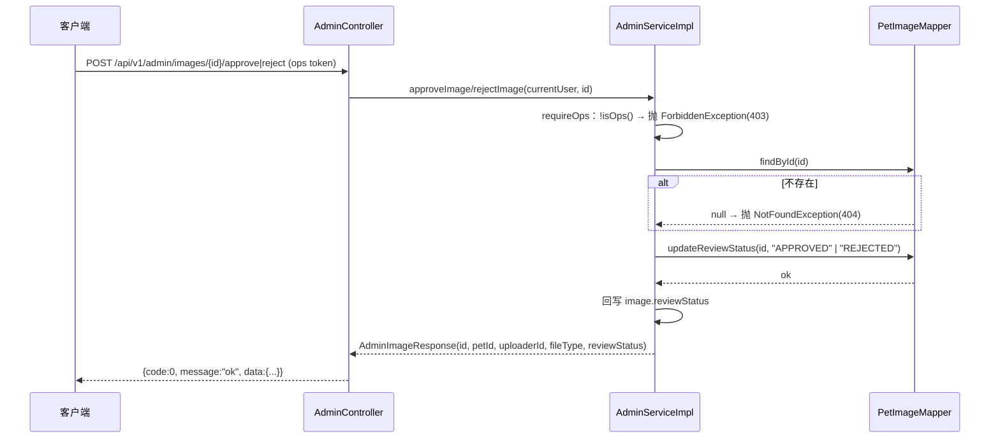
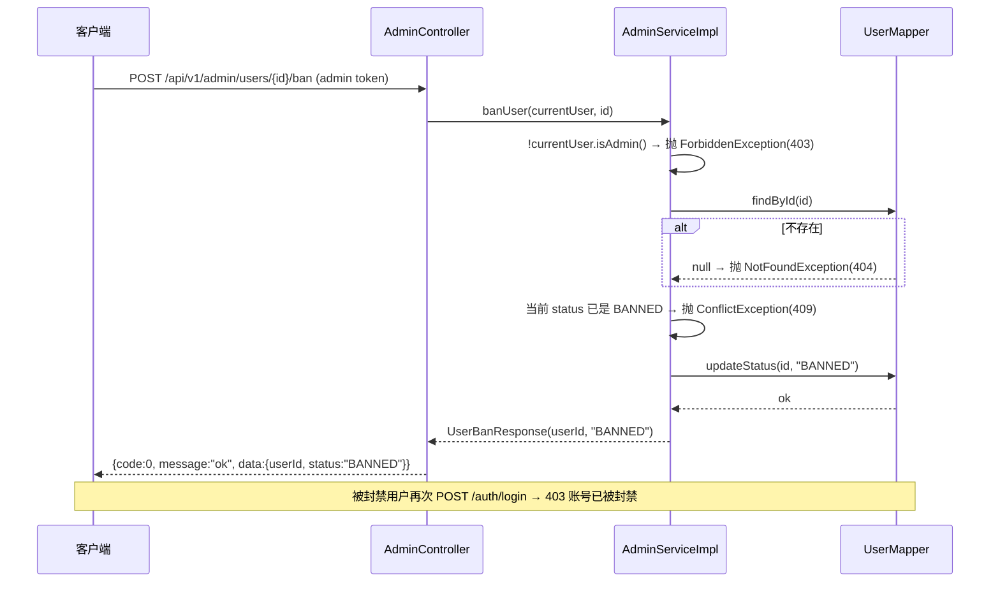
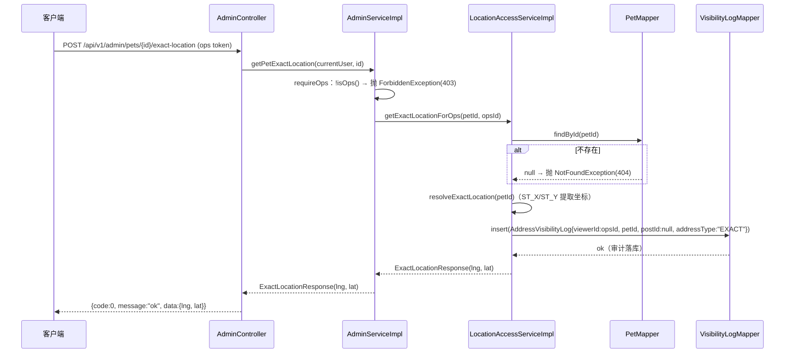

# 举报与运营功能说明

> 适用模块：`com.pethelp.report`、`com.pethelp.admin`、`com.pethelp.security`、`com.pethelp.post.mapper`、`com.pethelp.pet.mapper`、`com.pethelp.pet.service.impl.LocationAccessServiceImpl`、`com.pethelp.user.mapper`、`com.pethelp.auth.service.impl.AuthServiceImpl`
> 技术栈：Spring Boot 3.5 + MyBatis + PostgreSQL/PostGIS + Redis + Spring Security（JWT 无状态）

## 1. 举报与运营流程

### 1.1 举报创建时序图



### 1.2 举报处理时序图



### 1.3 帖子审核时序图（下架 / 驳回 / 恢复）



### 1.4 图片审核时序图（通过 / 驳回）



### 1.5 封禁时序图



### 1.6 精确位置访问时序图



## 2. 重要说明

- **自动过审 + 事后处置（关键设计）**：图片上传恒自动 `APPROVED`、帖子发布恒自动 `OPEN`（`verified_at=now`），运营端点是**事后监管**而非 PENDING 门槛——`reject`/`take-down`/`verify`/`approve` 只对已上线内容做二次审核，避免破坏 v0.1 已跑通的领养闭环。
- **角色模型**：`CurrentUser.isOps()` = `ops` 或 `admin`；`isAdmin()` = 仅 `admin`。封禁（ban）要求 `admin`（`!isAdmin()` → 403「仅管理员可封禁」），其余运营操作要求 `ops`/`admin`（`requireOps`）。
- **双层鉴权**：`SecurityConfig` 在过滤层对 `/api/v1/admin/**` 用 `hasAnyRole("ops","admin")` 拦截，普通用户命中 `RestAccessDeniedHandler` 得 `403/40300`「无权限访问」；服务层再以 `requireOps`/`isAdmin` 做纵深防御（`ForbiddenException`）。两处同码 `40300`。
- **举报状态机**：`PENDING → RESOLVED | DISMISSED`，单次终结。`ReportMapper.handle` 以 `WHERE id=? AND status='PENDING'` 幂等，重复处理落 409。
- **举报目标类型**：`PET` / `POST` / `USER` 三种，创建时按类型切到对应 mapper 校验目标存在，否则 404。
- **帖子审核状态前置**：`takeDown`/`reject` 仅对 `OPEN`/`RESERVED` 生效（0 行 → 409）；`verify` 仅对 `REJECTED` 生效（`→OPEN` 并写 `verified_at`）。
- **精确位置审计**：ops 访问精确坐标**跳过授权门槛**，但每次落一行 `address_visibility_logs`（`viewer_id=ops`、`address_type=EXACT`、`post_id=null`）留痕。
- **封禁即登录拦截**：`AuthServiceImpl.login` 在 `findByPhone` 后优先判 `status='BANNED'` 抛 `ForbiddenException("账号已被封禁")`，先于验证码校验。
- **列表分页**：`/admin/reports`、`/admin/posts`、`/admin/images` 均为 `page`（默认 1）+ `size`（默认 20），`page<1 || size<1` 抛 400；可选 `status`/`reviewStatus` 过滤；响应为纯数组，**不含 total 分页元数据**。
- **本期不做（deferred）**：举报处理联动自动下架目标内容（`RESOLVED` 仅改举报状态，不动目标）；举报原因枚举/反垃圾；解封（unban）端点；真实/异步图片审核；分页 total 计数。

## 3. 异常与错误码

统一返回 `{ code, message, data }`，`code` 前三位对应 HTTP 状态码。

| 场景 | 触发点 | HTTP | code | message |
|---|---|---|---|---|
| 举报目标类型非法 | `ReportServiceImpl.create` | 400 | 40000 | 举报目标类型非法 |
| 举报目标不存在 | `create` 目标存在性校验 | 404 | 40400 | 举报目标不存在 |
| 举报原因不能为空 | `create` 校验 | 400 | 40000 | 举报原因不能为空 |
| 处理动作非法 | `ReportServiceImpl.handle` | 400 | 40000 | 处理动作非法 |
| 分页参数非法 | `list`（举报/帖子/图片） | 400 | 40000 | 分页参数非法 |
| 举报不存在 | `handle` | 404 | 40400 | 举报不存在 |
| 举报已处理 | `handle`（status != PENDING） | 409 | 40900 | 举报已处理 |
| 非运营人员处理举报 | `handle`（!isOps） | 403 | 40300 | 仅运营人员可处理举报 |
| 帖子不存在 | `takeDown/reject/verify` | 404 | 40400 | 帖子不存在 |
| 驳回原因不能为空 | `rejectPost` | 400 | 40000 | 驳回原因不能为空 |
| 当前状态不可下架 | `takeDown`（0 行） | 409 | 40900 | 当前状态不可下架 |
| 当前状态不可驳回 | `reject`（0 行） | 409 | 40900 | 当前状态不可驳回 |
| 当前状态不可恢复 | `verify`（0 行） | 409 | 40900 | 当前状态不可恢复 |
| 图片不存在 | `approveImage/rejectImage` | 404 | 40400 | 图片不存在 |
| 用户不存在 | `banUser` | 404 | 40400 | 用户不存在 |
| 用户已被封禁 | `banUser`（已 BANNED） | 409 | 40900 | 用户已被封禁 |
| 仅管理员可封禁 | `banUser`（!isAdmin） | 403 | 40300 | 仅管理员可封禁 |
| 仅运营人员可操作 | `requireOps`（帖子/图片/精确位置） | 403 | 40300 | 仅运营人员可操作 |
| 宠物不存在 | `getExactLocationForOps` | 404 | 40400 | 宠物不存在 |
| 无权限访问 | `RestAccessDeniedHandler`（角色门禁） | 403 | 40300 | 无权限访问 |
| 账号已被封禁 | `AuthServiceImpl.login`（BANNED） | 403 | 40300 | 账号已被封禁 |

**说明**

- `BadRequestException` / `ForbiddenException` / `NotFoundException` / `ConflictException` 均继承 `BusinessException`，由 `GlobalExceptionHandler.handleBusiness` 统一映射。
- 运营端点的 403 有两处来源：过滤层 `RestAccessDeniedHandler`（普通用户直连 `/admin/**`）与服务层 `ForbiddenException`（纵深防御），二者 message 不同但 code 同为 `40300`。
- 帖子/图片审核的 409 不是「对象冲突」，而是「状态前置不满足」（`UPDATE ... WHERE` 影响 0 行），用于拒绝非法的状态转移（如对已下架帖子再次下架）。

## 4. 接口调试步骤

### 4.1 启动

```bash
# 1. 启动基础设施（PostgreSQL + PostGIS + Redis），compose 文件在 backend/ 下
cd backend
docker compose up -d
docker compose ps        # 等待 postgres / redis STATUS 为 healthy

# 2. 设置环境变量（DB_PASSWORD 必填，compose 与后端共用）

# 3. 启动后端
mvn spring-boot:run
```

默认端口 `8080`；健康检查：`curl http://localhost:8080/actuator/health` → `{"status":"UP",...}`。

### 4.2 调用接口（curl 示例）

普通用户登录取 `<user-jwt>` 见 `docs/archive/login-flow.md`。运营/管理员 `<ops-jwt>`、`<admin-jwt>` 需给用户赋角色（数据库 `users.roles` 加 `ops` / `admin`）后走同一登录流程，或直接由测试夹具签发。

**① 造举报目标：发布宠物 + 发帖**

```bash
curl -X POST http://localhost:8080/api/v1/pets \
  -H "Content-Type: application/json" -H "Authorization: Bearer <user-jwt>" \
  -d '{"species":"CAT"}'
# → {"code":0,"message":"ok","data":{"id":1,"status":"DRAFT",...}}

curl -X POST http://localhost:8080/api/v1/pets/1/publish -H "Authorization: Bearer <user-jwt>"
# → {"code":0,"message":"ok","data":{"id":1,"status":"ACTIVE",...}}

curl -X POST http://localhost:8080/api/v1/pet-posts \
  -H "Content-Type: application/json" -H "Authorization: Bearer <user-jwt>" \
  -d '{"petId":1,"postType":"FINDING","title":"寻宠","description":"走失猫咪"}'
# → {"code":0,"message":"ok","data":{"id":3,"status":"OPEN",...}}
```

**② 举报帖子**

```bash
curl -X POST http://localhost:8080/api/v1/reports \
  -H "Content-Type: application/json" -H "Authorization: Bearer <user-jwt>" \
  -d '{"targetType":"POST","targetId":3,"reason":"垃圾信息"}'
# → {"code":0,"message":"ok","data":{"id":5,"reporterId":1,"targetType":"POST","targetId":3,"reason":"垃圾信息","status":"PENDING","handledBy":null,"createdAt":"..."}}
```

**③ 运营处理举报**

```bash
curl http://localhost:8080/api/v1/admin/reports -H "Authorization: Bearer <ops-jwt>"
# → {"code":0,"message":"ok","data":[{...status:"PENDING"...}]}

curl -X POST http://localhost:8080/api/v1/admin/reports/5/handle \
  -H "Content-Type: application/json" -H "Authorization: Bearer <ops-jwt>" \
  -d '{"action":"RESOLVED"}'
# → {"code":0,"message":"ok","data":{"id":5,"status":"RESOLVED","handledBy":2,...}}
```

**④ 运营下架 / 驳回 / 恢复帖子**

```bash
curl -X POST http://localhost:8080/api/v1/admin/posts/3/reject \
  -H "Content-Type: application/json" -H "Authorization: Bearer <ops-jwt>" \
  -d '{"reason":"违规内容"}'
# → {"code":0,"message":"ok","data":{"id":3,"status":"REJECTED",...}}

curl -X POST http://localhost:8080/api/v1/admin/posts/3/verify -H "Authorization: Bearer <ops-jwt>"
# → {"code":0,"message":"ok","data":{"id":3,"status":"OPEN",...}}
```

**⑤ 运营审核图片**

```bash
curl -X POST http://localhost:8080/api/v1/pets/1/images \
  -H "Authorization: Bearer <user-jwt>" -F "file=@/path/to/a.png"
# → {"code":0,"message":"ok","data":{"id":7,"reviewStatus":"APPROVED",...}}

curl -X POST http://localhost:8080/api/v1/admin/images/7/reject -H "Authorization: Bearer <ops-jwt>"
# → {"code":0,"message":"ok","data":{"id":7,"reviewStatus":"REJECTED",...}}

curl -X POST http://localhost:8080/api/v1/admin/images/7/approve -H "Authorization: Bearer <ops-jwt>"
# → {"code":0,"message":"ok","data":{"id":7,"reviewStatus":"APPROVED",...}}
```

**⑥ 管理员封禁**

```bash
curl -X POST http://localhost:8080/api/v1/admin/users/1/ban -H "Authorization: Bearer <admin-jwt>"
# → {"code":0,"message":"ok","data":{"userId":1,"status":"BANNED"}}
```

**⑦ 运营查看精确位置（带审计）**

```bash
curl -X POST http://localhost:8080/api/v1/admin/pets/1/exact-location -H "Authorization: Bearer <ops-jwt>"
# → {"code":0,"message":"ok","data":{"lng":116.397,"lat":39.908}}
```

### 4.3 错误响应示例

```bash
# 普通用户直连 admin（角色门禁）
curl http://localhost:8080/api/v1/admin/reports -H "Authorization: Bearer <user-jwt>"
# → HTTP 403 {"code":40300,"message":"无权限访问","data":null}

# 举报不存在的目标
curl -X POST http://localhost:8080/api/v1/reports \
  -H "Content-Type: application/json" -H "Authorization: Bearer <user-jwt>" \
  -d '{"targetType":"POST","targetId":999999,"reason":"x"}'
# → HTTP 404 {"code":40400,"message":"举报目标不存在","data":null}

# 重复处理举报
curl -X POST http://localhost:8080/api/v1/admin/reports/5/handle \
  -H "Content-Type: application/json" -H "Authorization: Bearer <ops-jwt>" \
  -d '{"action":"RESOLVED"}'
# → HTTP 409 {"code":40900,"message":"举报已处理","data":null}

# 对已下架帖子再次下架（状态前置不满足）
curl -X POST http://localhost:8080/api/v1/admin/posts/3/take-down -H "Authorization: Bearer <ops-jwt>"
curl -X POST http://localhost:8080/api/v1/admin/posts/3/take-down -H "Authorization: Bearer <ops-jwt>"
# → HTTP 409 {"code":40900,"message":"当前状态不可下架","data":null}

# ops 角色封禁（仅管理员可封禁）
curl -X POST http://localhost:8080/api/v1/admin/users/1/ban -H "Authorization: Bearer <ops-jwt>"
# → HTTP 403 {"code":40300,"message":"仅管理员可封禁","data":null}

# 被封禁用户登录
curl -X POST http://localhost:8080/api/v1/auth/login \
  -H "Content-Type: application/json" -d '{"phone":"13900138300","code":"000000"}'
# → HTTP 403 {"code":40300,"message":"账号已被封禁","data":null}
```
